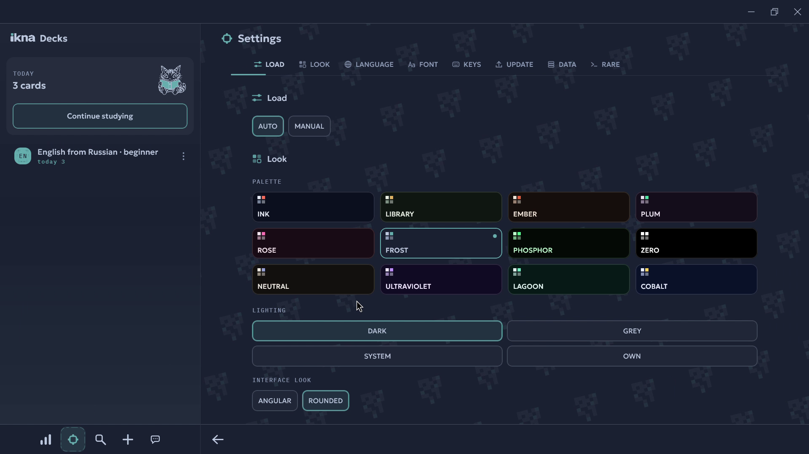

  

<h1 align="center" id="ikna">ikna</h1>

  <strong>English</strong> · <a href="#русский">Русский</a>

  Flashcards for learning a language in context. 
  Read a phrase in a sentence, reveal its meaning, and answer “know” or “don’t know”. Ikna schedules reviews and decides how much new material fits today.

  <a href="#download"><strong>Download</strong></a> · Android, Windows and Linux

  
  
  
  

  
  
  

##  What is Ikna?

Ikna builds a daily plan from the cards you have due and your recent study history. You can start with the included beginner English deck for Russian speakers, pick a deck from the catalogue, or bring your own.

##  How it works

1. **Read.** “Can you **keep an eye on** my bag?”
2. **Reveal.** “Can you watch my bag for a moment?”
3. **Grade.** Choose “know” or “don’t know”. Ikna uses your answer to schedule the next review.

FSRS‑6 schedules reviews. `riar-manage` decides how much new material fits in the day. After the daily plan, you can read familiar material in Browse. [Learning engine](docs/contracts/LEARNING-ENGINE.md) · [Daily workload](docs/contracts/GOVERNOR.md)

##  Download

These files are from [the published 0.12.0 press release](https://github.com/d1d2dopamine/ikna/releases/tag/v0.12.0-press). See [release notes](docs/RELEASE-NOTES-0.12.0.md) for what's new.

| Platform | Download |
| --- | --- |
| Android 10+ (arm64) | [APK](https://github.com/d1d2dopamine/ikna/releases/download/v0.12.0-press/ikna-android-arm64.apk) |
| Android 10+ (32-bit ARM) | [32-bit APK](https://github.com/d1d2dopamine/ikna/releases/download/v0.12.0-press/ikna-android-legacy32.apk) |
| Windows x64 | [Installer](https://github.com/d1d2dopamine/ikna/releases/download/v0.12.0-press/ikna-windows-x64-setup.exe) · [Portable ZIP](https://github.com/d1d2dopamine/ikna/releases/download/v0.12.0-press/ikna-windows-x64-portable.zip) |
| Linux x86_64 | [AppImage](https://github.com/d1d2dopamine/ikna/releases/download/v0.12.0-press/ikna-linux-x86_64.AppImage) |

The Windows installer runs per user. The portable Windows build and the Linux AppImage ship with their runtime. On Linux, mark the AppImage executable before opening it. [Desktop setup](docs/contracts/DESKTOP.md) · [Updates](docs/contracts/UPDATES.md)

##  Decks

- [Catalogue](docs/contracts/SOURCES.md). Choose a ready-made deck. Catalogue cards retain source and licence information.
- [Your own deck](docs/contracts/DECKS.md). Paste rows in the form `phrase | example sentence | meaning`. Ikna can also prepare a prompt for an AI tool you choose.
- [Anki import](docs/contracts/ANKI.md). Open an `.apkg` to import supported text cards and their review history. Images and audio are left out.

##  Privacy and data

Ikna stores cards and review history on your device. It has no accounts or analytics. You can export a backup and restore your history. The development branch also has optional local sync between devices you explicitly pair. [Privacy policy](PRIVACY.md) · [Local sync](docs/contracts/SYNC-PROFILES-0.12.md)

##  Interface

Choose a palette, angular or rounded controls, and whether animations are on. Android includes a widget and a daily reminder. The interface is available in Russian, English, Polish, Spanish, French, German and Brazilian Portuguese. [Interface design](docs/DESIGN.md)

https://github.com/user-attachments/assets/c90d603c-693f-4c9d-9915-55f04d7c0f5b

| Review | Themes & settings |
| :---: | :---: |
|  |  |
| **Catalogue** | **About Ikna** |
|  |  |

##  Build

[GitHub Actions](https://github.com/d1d2dopamine/ikna/actions/workflows/build.yml) builds Android, Windows and Linux. The [contributor guide](CONTRIBUTING.md) covers building locally and running tests.

##  Documentation

[Architecture](docs/ARCHITECTURE.md) · [Changelog](CHANGELOG.md) · [0.12 working plan](docs/PLAN-0.12.md) · [Repository instructions](AGENTS.md)

##  License

Ikna is free software under the [GNU General Public License, version 3 or later](LICENSE).

---

  

<h1 align="center">Икна</h1>

  <a href="#ikna">English</a> · <strong>Русский</strong>

  Карточки для изучения языка в контексте. 
  Прочитай фразу в предложении, открой её значение и ответь «знаю» или «не знаю». Икна сама назначает повторы и решает, сколько нового материала добавить на сегодня.

  <a href="#скачать"><strong>Скачать</strong></a> · Android, Windows и Linux

  
  
  
  

  
  
  

##  Что такое Икна

Икна собирает дневной план из карточек, которые пора повторить, и учитывает, как ты занимался в последние дни. Можно начать со встроенной колоды английского для начинающих с переводом на русский, выбрать колоду в каталоге или добавить свою.

##  Как это устроено

1. **Прочитай.** “Can you **keep an eye on** my bag?”
2. **Открой значение.** «Можешь присмотреть за моей сумкой?»
3. **Ответь.** Выбери «знаю» или «не знаю». По ответу Икна назначит следующий повтор.

Повторы планирует FSRS‑6. Сколько нового материала взять сегодня, решает `riar-manage`. После дневного плана знакомый материал можно почитать в режиме «Чтение». [Учебный движок](docs/contracts/LEARNING-ENGINE.md) · [Дневная нагрузка](docs/contracts/GOVERNOR.md)

##  Скачать

В таблице файлы [опубликованного релиза 0.12.0 press](https://github.com/d1d2dopamine/ikna/releases/tag/v0.12.0-press). Список изменений — в [описании релиза](docs/RELEASE-NOTES-0.12.0.md).

| Платформа | Скачать |
| --- | --- |
| Android 10+ (arm64) | [Основной APK](https://github.com/d1d2dopamine/ikna/releases/download/v0.12.0-press/ikna-android-arm64.apk) |
| Android 10+ (32-bit ARM) | [APK для старых устройств](https://github.com/d1d2dopamine/ikna/releases/download/v0.12.0-press/ikna-android-legacy32.apk) |
| Windows x64 | [Установщик](https://github.com/d1d2dopamine/ikna/releases/download/v0.12.0-press/ikna-windows-x64-setup.exe) · [Portable ZIP](https://github.com/d1d2dopamine/ikna/releases/download/v0.12.0-press/ikna-windows-x64-portable.zip) |
| Linux x86_64 | [AppImage](https://github.com/d1d2dopamine/ikna/releases/download/v0.12.0-press/ikna-linux-x86_64.AppImage) |

Установщик Windows ставит Икну для текущего пользователя. Portable-версия Windows и AppImage для Linux поставляются со своей средой запуска. В Linux перед первым запуском дай AppImage право на выполнение. [Установка на ПК](docs/contracts/DESKTOP.md) · [Обновления](docs/contracts/UPDATES.md)

##  Колоды

- [Каталог](docs/contracts/SOURCES.md). Выбери готовую колоду. В карточках каталога сохраняются сведения об источнике и лицензии.
- [Своя колода](docs/contracts/DECKS.md). Вставь строки в формате `фраза | предложение с ней | значение`. Икна также может подготовить запрос для выбранного тобой ИИ.
- [Импорт из Anki](docs/contracts/ANKI.md). Открой `.apkg`, чтобы перенести поддерживаемые текстовые карточки вместе с историей ответов. Изображения и аудио остаются в Anki.

##  Приватность и данные

Икна хранит карточки и историю ответов на устройстве. Аккаунтов и аналитики нет. Историю можно сохранить в резервную копию и восстановить из неё. В ветке разработки также есть локальная синхронизация, которую можно включить для сопряжённых устройств. [Политика приватности](PRIVACY.md) · [Локальная синхронизация](docs/contracts/SYNC-PROFILES-0.12.md)

##  Интерфейс

Можно выбрать палитру, угловатые или скруглённые элементы и отключить анимации. На Android есть виджет и ежедневное напоминание. Интерфейс доступен на русском, английском, польском, испанском, французском, немецком и бразильском португальском. [Дизайн интерфейса](docs/DESIGN.md)

https://github.com/user-attachments/assets/c90d603c-693f-4c9d-9915-55f04d7c0f5b

| Повторение карточек | Палитры и настройки |
| :---: | :---: |
|  |  |
| **Каталог колод** | **Об Икне** |
|  |  |

##  Сборка

[GitHub Actions](https://github.com/d1d2dopamine/ikna/actions/workflows/build.yml) собирает Икну для Android, Windows и Linux. Локальная сборка и запуск тестов описаны в [руководстве для разработчиков](CONTRIBUTING.md).

##  Документация

[Архитектура](docs/ARCHITECTURE.md) · [История изменений](CHANGELOG.md) · [План 0.12](docs/PLAN-0.12.md) · [Инструкции для контрибьюторов](AGENTS.md)

##  Лицензия

Икна распространяется по [GNU General Public License версии 3 или более поздней](LICENSE).
