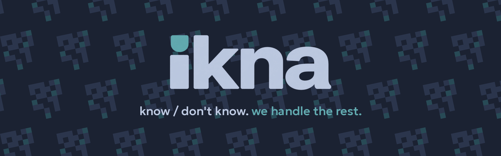
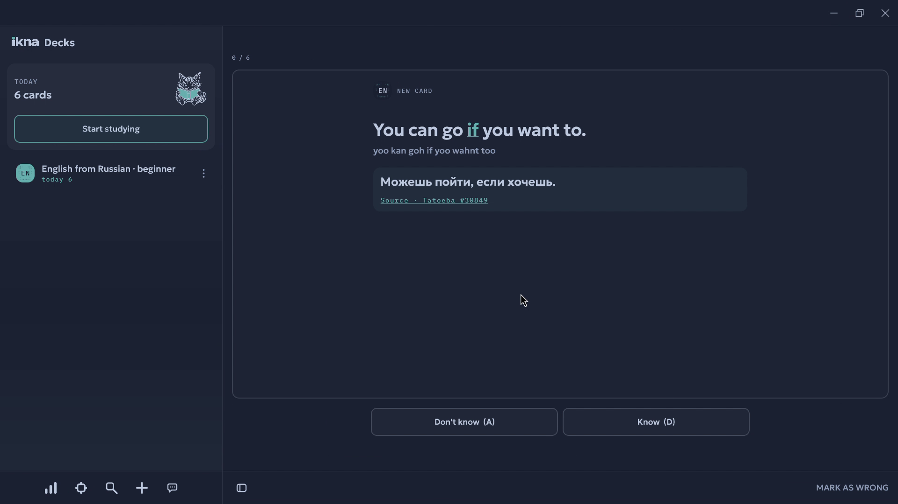
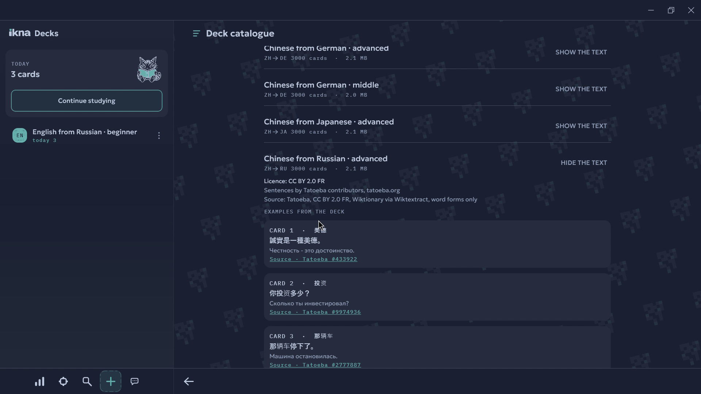
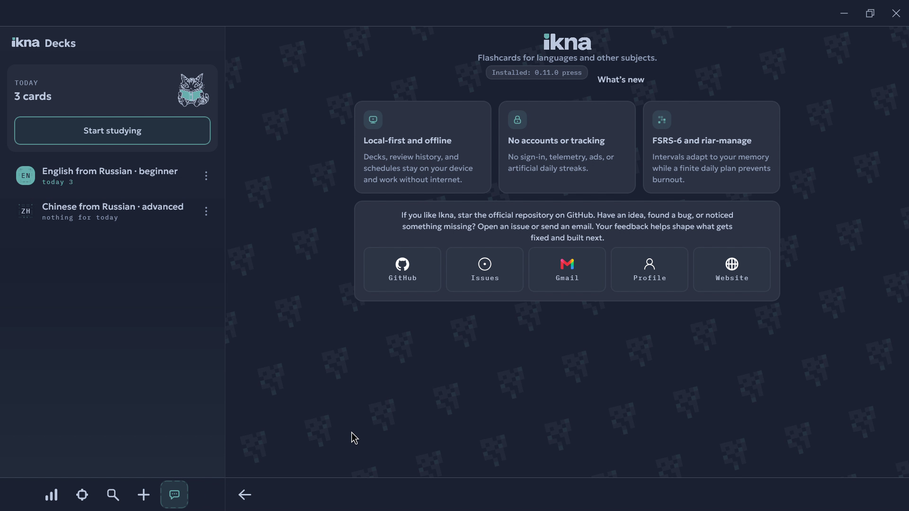

  

<h1 align="center" id="ikna">ikna</h1>

  <strong>English</strong> · <a href="README.ru.md">Русский</a>

  Language flashcards built around real sentences. 
  You answer "know" or "don't know", and Ikna paces your daily queue so a missed week never turns into a wall of overdue cards.

  <a href="#download"><strong>Download (0.13.0)</strong></a> · Android, Windows and Linux

  
  
  
  

https://github.com/user-attachments/assets/c90d603c-693f-4c9d-9915-55f04d7c0f5b

| Review | Themes and settings |
| :---: | :---: |
|  |  |
| **Catalogue** | **About Ikna** |
|  |  |

##  How a session works

1. Read a phrase inside a sentence: "Can you **keep an eye on** my bag?"
2. Reveal the meaning: "Can you watch my bag for a moment?"
3. Pick "know" or "don't know".

Ikna builds one finite plan for the day from cards that are due and your recent study pace. Reviews are scheduled with FSRS-6, while `riar-manage` decides how many new cards fit without overloading next week. Once you finish the daily plan, you can stop there, practice difficult cards, or read familiar material in Browse. [Learning engine](docs/contracts/LEARNING-ENGINE.md) · [Daily workload](docs/contracts/GOVERNOR.md)

##  Why Ikna feels different

Most flashcard apps punish you for taking a break. Miss ten days and you open the app to 400 overdue cards and a broken streak. Ikna handles gaps differently: overdue cards move into an amnesty pool and come back in small pieces alongside regular reviews, and there are no streaks to lose.

Every card asks for a simple binary choice ("know" or "don't know") instead of four overlapping buttons. Cards teach phrases inside natural sentences, and once a card matures, Ikna can rotate through additional sentences from the catalogue so you recognize the phrase outside one memorized line.

Everything runs offline on your device. There are no accounts, subscriptions, ads, or analytics. You get a local profile with activity and retention stats, optional PNG progress card export, full history backups, and optional direct sync between paired devices on your own network.

##  Download

Files from [release 0.13.0 press](https://github.com/d1d2dopamine/ikna/releases/tag/v0.13.0-press) ([release notes](docs/RELEASE-NOTES-0.13.0.md)):

| Platform | File | Which one to pick |
| --- | --- | --- |
| Android 10+ (arm64) | [APK](https://github.com/d1d2dopamine/ikna/releases/download/v0.13.0-press/ikna-android-arm64.apk) | Almost all modern Android phones |
| Android 10+ (32-bit ARM) | [32-bit APK](https://github.com/d1d2dopamine/ikna/releases/download/v0.13.0-press/ikna-android-legacy32.apk) | Older 32-bit Android devices |
| Windows x64 | [Installer](https://github.com/d1d2dopamine/ikna/releases/download/v0.13.0-press/ikna-windows-x64-setup.exe) · [Portable ZIP](https://github.com/d1d2dopamine/ikna/releases/download/v0.13.0-press/ikna-windows-x64-portable.zip) | Installer for normal setup, ZIP to run without installing |
| Linux x86_64 | [AppImage](https://github.com/d1d2dopamine/ikna/releases/download/v0.13.0-press/ikna-linux-x86_64.AppImage) | Mark executable (`chmod +x`) before opening |

The Windows installer installs for the current user only. Both the portable Windows build and the Linux AppImage include their own runtime. [Desktop setup](docs/contracts/DESKTOP.md) · [Updates](docs/contracts/UPDATES.md)

##  Decks and Anki import

You can start immediately with the bundled English beginner deck (for Russian speakers), install ready-made decks from the [catalogue](docs/contracts/SOURCES.md) with source and licence metadata preserved on each card, or paste your own rows in the format `phrase | example sentence | meaning`. Ikna can also generate a prompt you can paste into any AI tool to draft a custom deck. [Custom decks](docs/contracts/DECKS.md)

If you already use Anki, open any `.apkg` file to import supported text cards together with their review history. Images and audio stay in Anki. [Anki import](docs/contracts/ANKI.md)

##  Interface and privacy

You can switch colour palettes, choose angular or rounded controls, pick custom deck backgrounds, turn animations on or off, and listen to cards with offline voice playback. Android includes a home screen widget and a daily reminder. The interface supports Russian, English, Polish, Spanish, French, German, and Brazilian Portuguese. [Interface design](docs/DESIGN.md)

All cards, review logs, and profile data stay local on your device. You can export and restore your full history at any time, or pair two of your own devices for direct local sync. [Privacy policy](PRIVACY.md) · [Local sync](docs/contracts/SYNC-PROFILES-0.12.md)

##  Build, docs and license

[GitHub Actions](https://github.com/d1d2dopamine/ikna/actions/workflows/build.yml) builds Android, Windows, and Linux. See [CONTRIBUTING.md](CONTRIBUTING.md) for local builds and tests.

[Documentation index](docs/DOCUMENTATION.md) · [Architecture](docs/ARCHITECTURE.md) · [Changelog](CHANGELOG.md) · [Repository instructions](AGENTS.md)

Ikna is free software licensed under the [GNU General Public License, version 3 or later](LICENSE).
