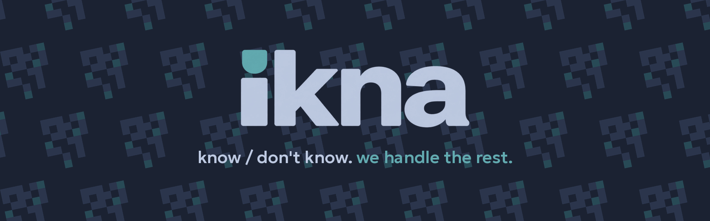
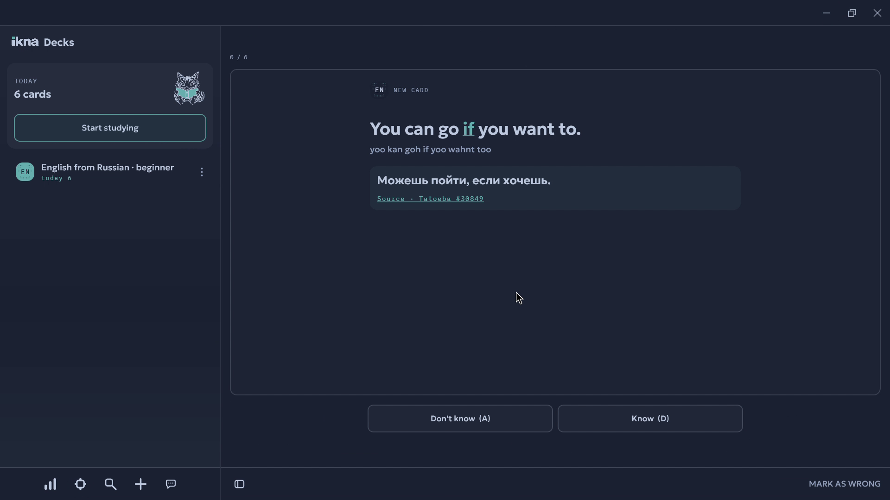
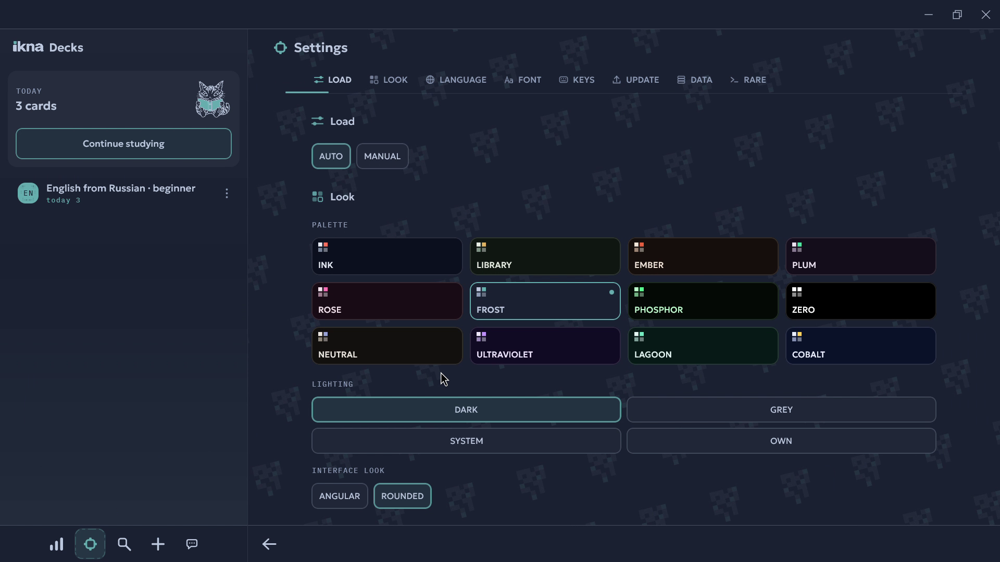
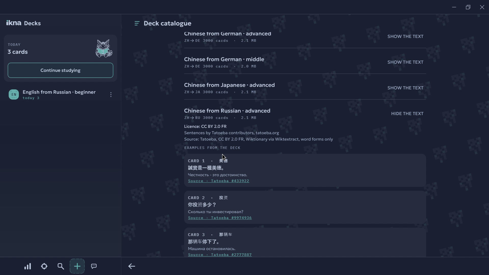
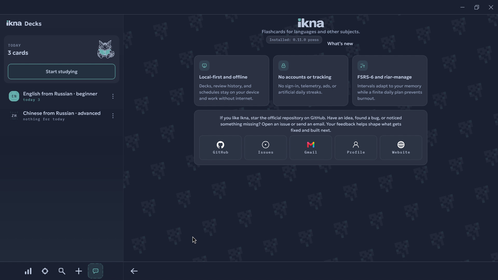

  

<h1 align="center" id="ikna">Икна</h1>

  <a href="README.md">English</a> · <strong>Русский</strong>

  Карточки для изучения языков по живым предложениям. 
  Ты отвечаешь «знаю» или «не знаю», а Икна сама дозирует дневную очередь, чтобы пропущенная неделя не превращалась в завал из просроченных карточек.

  <a href="#скачать"><strong>Скачать (0.14.0)</strong></a> · Android, Windows и Linux

  
  
  
  

https://github.com/user-attachments/assets/c90d603c-693f-4c9d-9915-55f04d7c0f5b

| Повторение карточек | Палитры и настройки |
| :---: | :---: |
|  |  |
| **Каталог колод** | **Об Икне** |
|  |  |

##  Как проходит сессия

1. Прочитай фразу в предложении: "Can you **keep an eye on** my bag?"
2. Открой значение: «Можешь присмотреть за моей сумкой?»
3. Выбери «знаю» или «не знаю».

Икна собирает один конечный план на день из карточек, которые пора повторить, и учитывает твой реальный темп за последние дни. Интервалы повторений считает FSRS-6, а `riar-manage` решает, сколько нового материала добавить сегодня без перегруза на следующей неделе. После дневного плана можно спокойно закрыть приложение, потренировать сложные карточки или почитать знакомые фразы в режиме «Чтение». [Учебный движок](docs/contracts/LEARNING-ENGINE.md) · [Дневная нагрузка](docs/contracts/GOVERNOR.md)

##  Почему Икна устроена именно так

Большинство приложений с карточками наказывают за перерыв. Пропустил десять дней, открыл приложение и получил 400 просроченных карточек со сгоревшим стриком. В Икне старые карточки уходят в пул амнистии и возвращаются небольшими порциями рядом с обычными повторениями, а стриков здесь нет вовсе.

На карточке всего две кнопки («знаю» и «не знаю») вместо четырёх похожих оценок. Фразы учатся внутри живых предложений, а когда карточка окрепнет, Икна может показывать её в других предложениях из каталога, чтобы выражение узнавалось не только в одном заученном примере.

Всё работает офлайн на твоём устройстве, без аккаунтов, подписок, рекламы и аналитики. Внутри есть локальный профиль со статистикой и экспортом PNG-карточки прогресса, полные резервные копии истории и опциональная локальная синхронизация между твоими устройствами.

##  Скачать

Файлы [релиза 0.14.0 press](https://github.com/d1d2dopamine/ikna/releases/tag/v0.14.0-press) ([список изменений](docs/RELEASE-NOTES-0.14.0.md)):

| Платформа | Файл | Какой выбрать |
| --- | --- | --- |
| Android 10+ (arm64) | [Основной APK](https://github.com/d1d2dopamine/ikna/releases/download/v0.14.0-press/ikna-android-arm64.apk) | Подойдёт почти для всех современных телефонов |
| Android 10+ (32-bit ARM) | [32-bit APK](https://github.com/d1d2dopamine/ikna/releases/download/v0.14.0-press/ikna-android-legacy32.apk) | Для старых 32-битных устройств |
| Windows x64 | [Установщик](https://github.com/d1d2dopamine/ikna/releases/download/v0.14.0-press/ikna-windows-x64-setup.exe) · [Portable ZIP](https://github.com/d1d2dopamine/ikna/releases/download/v0.14.0-press/ikna-windows-x64-portable.zip) | Установщик для обычной установки, ZIP для запуска без неё |
| Linux x86_64 | [AppImage](https://github.com/d1d2dopamine/ikna/releases/download/v0.14.0-press/ikna-linux-x86_64.AppImage) | Перед первым запуском дай право на выполнение (`chmod +x`) |

Установщик Windows ставит Икну только для текущего пользователя. Portable-версия Windows и AppImage для Linux уже содержат нужную среду запуска. [Установка на ПК](docs/contracts/DESKTOP.md) · [Обновления](docs/contracts/UPDATES.md)

##  Колоды и переезд из Anki

Можно начать сразу со встроенной колоды английского для начинающих, выбрать готовую колоду в [каталоге](docs/contracts/SOURCES.md) (у карточек сохраняются источник и лицензия) или добавить свою в формате `фраза | предложение с ней | значение`. Икна также умеет собрать готовый промпт для любой удобной нейросети, чтобы быстро подготовить колоду под твою тему. [Своя колода](docs/contracts/DECKS.md)

Если ты уже пользовался Anki, просто открой файл `.apkg`: Икна перенесёт поддерживаемые текстовые карточки вместе с историей повторений. Картинки и аудио остаются в Anki. [Импорт из Anki](docs/contracts/ANKI.md)

##  Интерфейс и приватность

Можно выбрать палитру, угловатые или скруглённые элементы, поставить свой фон колоды, отключить анимации и включить офлайн-озвучку карточек. На Android есть виджет на рабочий стол и ежедневное напоминание. Интерфейс переведён на русский, английский, польский, испанский, французский, немецкий и бразильский португальский. [Дизайн интерфейса](docs/DESIGN.md)

Все карточки, журнал ответов и локальный профиль хранятся только на устройстве. Историю можно в любой момент выгрузить в резервную копию и восстановить, либо связать два своих устройства для локальной синхронизации. [Политика приватности](PRIVACY.md) · [Локальная синхронизация](docs/contracts/SYNC-PROFILES-0.12.md)

##  Сборка, документация и лицензия

[GitHub Actions](https://github.com/d1d2dopamine/ikna/actions/workflows/build.yml) собирает Android, Windows и Linux. Локальная сборка и тесты описаны в [CONTRIBUTING.md](CONTRIBUTING.md).

[Вся документация](docs/DOCUMENTATION.md) · [Архитектура](docs/ARCHITECTURE.md) · [История изменений](CHANGELOG.md) · [Инструкции для контрибьюторов](AGENTS.md)

Икна распространяется по [GNU General Public License версии 3 или более поздней](LICENSE).
